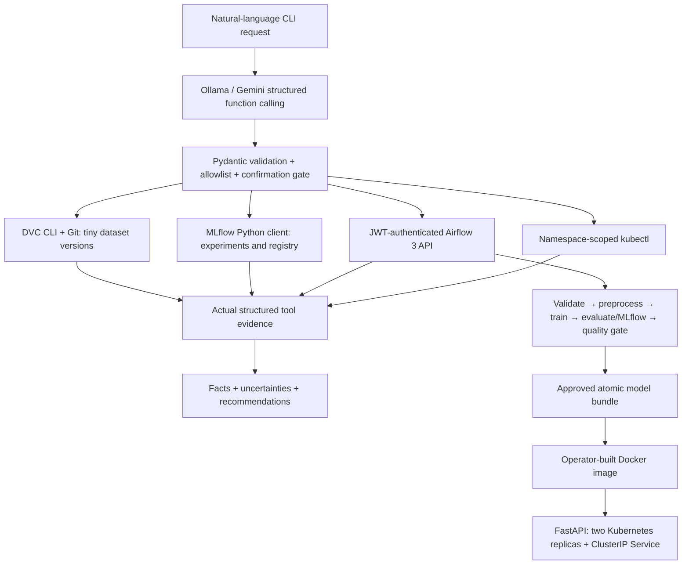

# Technical report — Assignment 03

**Repository:** [MasabTahir732/assignment-03-mlops-agent](https://github.com/MasabTahir732/assignment-03-mlops-agent)

## 1. Complete system architecture

Iris **v1 = 120 rows / 2,217 bytes** and **v2 = 150 rows / 2,757 bytes**.
Both versions use a local DVC remote; Git stores their pointers and immutable tags.
The training split and random seed are fixed. Training records dataset hash,
dataset Git commit/tag and training source commit independently. MLflow retains
metrics, parameters, artifacts and gate status. Only passing candidates are
registered and promoted. Image rebuilding/deployment remains an explicit operation.

Airflow exposes five separate tasks with dependencies, logging and one retry.
Kubernetes provides two desired replicas, readiness/liveness probes, CPU/memory
requests and limits, a ConfigMap and a ClusterIP Service. Inference `/metadata`
reports the actual loaded model run ID and dataset hash.

## 2. Tool definitions and permissions

There are **22 callable tools**, exceeding the three-per-module requirement.
Their complete validated input schemas are exported with `python -m agent.main
--list-tools`; [architecture.md](architecture.md#tool-definitions-and-permissions)
lists every tool and permission.

| Module | Read tools / functions | Authorized writes |
| --- | --- | --- |
| DVC (5) | List tracked datasets, inspect current version/status, compare revisions, explain reproduction | No conversational write tool; operator uses DVC setup/reproduction scripts |
| MLflow (6) | List experiments/runs, retrieve parameters/metrics/artifacts, rank candidates, compare runs, inspect registry | Training records experiments; conversational tools are read-only |
| Airflow (5) | List DAGs, inspect runs/tasks, retrieve available failure logs | Trigger only `iris_training`, with trusted CLI `--confirm` |
| Kubernetes (6) | Inspect application Pods/Deployments/Services, logs, readiness, restarts and events | Restart only `deployment/iris-api` in approved namespace, with `--confirm` and sufficient RBAC |

Model-generated confirmation cannot authorize a write. Invalid arguments and
unknown tools are rejected. Subprocesses use argument lists without a shell.
Structured audit logs record tool, status, duration and request ID without logging
credentials. `.env`, model binaries, DVC cache and Kubernetes credentials are ignored.
The supplied Kubernetes service account is read-only.

## 3. Actual infrastructure evidence

The first dedicated live integration run **passed** on 14 November 2026. Its
conversations were captured at **16:54 PKT** from real running services, separately
from mocked unit tests. [Successful workflow and logs](https://github.com/MasabTahir732/assignment-03-mlops-agent/actions/runs/43591743449).
The source commit for that run was `2611db0c3e9844f6fc95a337f68d82c31358f1ef`.

The assignment permits **screenshots or exported evidence**. These committed JSON
exports provide the actual tool responses without requiring expiring Actions artifacts:

| Technology | Export | Observed result |
| --- | --- | --- |
| DVC/Git | [dvc-comparison.json](screenshots/live/dvc-comparison.json) | v1 MD5 `4a3beb7462eb695a87c685647c3245c2`; v2 MD5 `4224576f0267bf88902f87f0f6200967`; distinct commits |
| MLflow | [conversations.json](screenshots/live/conversations.json) | Actual run metrics, parameters, artifacts and DVC provenance returned by supported client APIs |
| Airflow 3 | [pipeline.json](screenshots/live/pipeline.json) | Run `agent__7cb03a97fc4b4314b3d948a89a33c492` and all five tasks succeeded |
| Kubernetes | [kubernetes.json](screenshots/live/kubernetes.json) | Two Running/ready Pods, Deployment available replicas = 2, ClusterIP Service |
| Inference | [inference.json](screenshots/live/inference.json) | Loaded run `900804b0b83f4f85af88b621a977ae3e`, dataset v2, approved bundle |
| Failure recovery | [failure-investigations.json](screenshots/live/failure-investigations.json) | Both expected failures, actual task logs, unchanged approved model, successful recovery |

The deployed model recorded macro **F1 = 0.948718** and **accuracy = 0.947368**.
Its dataset commit is `6e987ba1193c5763d8ff59d883f794ed2c088a90`.
Dataset reproduction was also checked locally with a separate Git worktree and
`dvc pull`: v1 restored 120 rows with its expected MD5, preserving the active v2 file.

## 4. Five tested conversations

The five entries in [conversations.json](screenshots/live/conversations.json)
contain exact user requests, responses, request IDs, durations and actual evidence.
This initial infrastructure verification used the explicitly labeled **rules**
planner. Ollama is the supported local LLM for the live natural-language demonstration;
its separately exported LLM conversations are included when that verification completes.

| Scenario | Actual user request | Verified tool behavior |
| --- | --- | --- |
| Dataset provenance | “Which dataset version is current?” | DVC pointers, current hash, Git/data commits and status |
| Model selection | “Compare the recent runs and find the best model based on f1” | Metric ranking, selected run details/artifacts, recorded DVC reproduction reference |
| Pipeline execution | “Check the training pipeline status” | Actual Airflow runs, supplemented by the submitted/completed run and task evidence in `pipeline.json` |
| Deployment diagnosis | “Why is my prediction API unavailable?” | Actual Pod readiness/restarts, desired/available replicas, image, Services and relevant events/logs |
| Multi-tool reasoning | “Find the best recent model, identify the dataset version used to train it, check deployment status, and explain whether retraining is necessary.” | MLflow + DVC + Kubernetes + Airflow, with provenance follow-up |

The integrated response compares recorded candidate provenance to current DVC
state. It separates facts, missing information and actions. It does not equate a
high F1 with production readiness, invent a freshness policy, or trigger retraining.
Exact deployed-model identity is verified using the separate `/metadata` export.

## 5. Two actual failure investigations

**Validation failure.** Run `agent__febfa8a9abc44647b94d2e3638205137` failed in
`validate_data` after its retry. The explicit injected missing-target error is the
root cause; the other four tasks were `upstream_failed`, so training/promotion did
not proceed. The previous approved model's SHA-256 remained unchanged.

**Quality-gate failure.** Run `agent__5823b5b4c9e047f1af3d6b26c996cd18` reached
evaluation, logged actual MLflow metrics and then failed in `quality_gate` after its
retry. The injected threshold of **1.01** exceeds the possible F1 range. The gate
blocked promotion and registry entry; the previous approved model remained unchanged.

**Resolution verified:** remove both failure injections and rerun with the normal
validation and F1 >= 0.90 policy. Recovery run
`agent__b4f4e2bb5c5749d78d3a3708e75cf1ff` completed successfully. Actual task states,
log responses, root-cause descriptions, preservation checks and recovery are saved
in [failure-investigations.json](screenshots/live/failure-investigations.json).

An additional development issue was diagnosed: DVC's dependency resolver selected
an incompatible `pathspec` release. Pinning `pathspec==0.12.1` restored real DVC
operations. The user's Gemini project also returned 403 because its free tier was
unavailable; provider denial is reported explicitly and the local Ollama alternative
avoids making the assignment dependent on Gemini project eligibility.

## 6. Reliability, limitations and improvements

GitHub Actions runs Ruff and pytest on pull requests. The separate manual live-demo
workflow provisions real services and Kind Kubernetes rather than mocking them.
Tests cover success, tool selection, timeouts, invalid requests, unavailable
services, no invented results, unauthorized Kubernetes changes, model-granted
consent rejection, provider failures, secret-safe logs, validation, quality gates
and actual trained-model inference.

Known limitations: this is a single-host classroom system; Iris is too small to
prove real-world model robustness; a top metric is not a production readiness
assessment; LLM selection can be imperfect; CPU inference is slower than a cloud
provider; the local DVC remote must be regenerated/configured after cloning; no
automatic drift/freshness policy exists; image promotion/deployment is manual;
transitive dependencies are not fully hash-locked; health checks do not test all
external traffic paths. Gemini additionally requires an eligible project/key.

Proposed improvements: hash-locked environments, drift/freshness monitoring,
authenticated shared MLflow/DVC storage, centralized audit records, image signing,
retrieval-aware iterative planning, richer quality policies and a production
authorization layer for multiple users.
