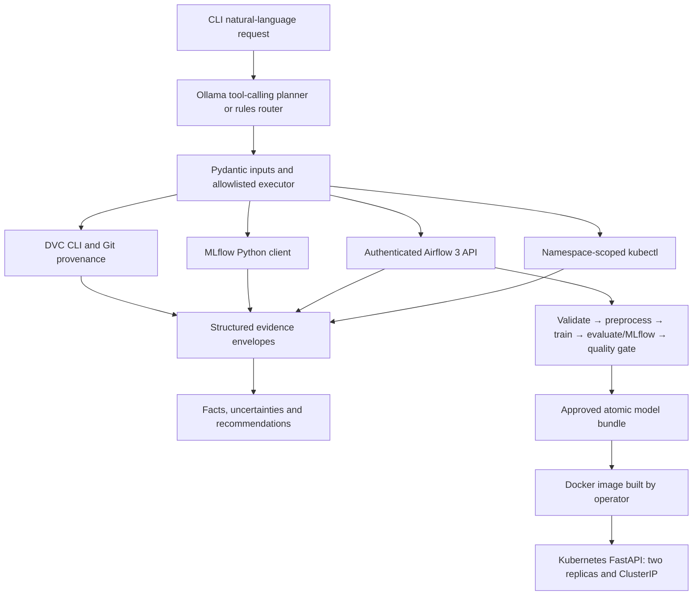

# Technical report — Tiny-data MLOps AI Agent

## Architecture

The conversational interface runs locally rather than exposing administrative
operations on the public inference API. In AI mode, Ollama returns structured tool
calls. The executor validates inputs, checks trusted CLI confirmation, calls only
registered functions, and wraps results with status, request ID and duration.
The response renderer makes operational claims only from successful tool output.
Rules mode exposes the same integrations for repeatable low-resource demonstrations.

DVC uses two sub-5-KB Iris datasets (120/150 rows), content-addressed cache, a local
remote and Git pointers/tags. Training verifies the file hash and clean tracked
source, uses a fixed stratified split and seed, and logs immutable provenance to
MLflow. Failed candidates are retained as experiment evidence. Only a passing
candidate is registered and promoted into an atomic model/metadata bundle.

Airflow executes five dependent TaskFlow tasks, one retry, and explicit task logs.
Per-run work directories isolate retries and separate workflow runs. Kubernetes
deploys an operator-built immutable image with two desired replicas, probes, resource
limits, non-root execution and ConfigMap configuration. `/metadata` exposes the
loaded model run ID and data hash so deployment provenance can be checked directly.

## Tool definitions and permissions

`python -m agent.main --list-tools` exports complete JSON schemas. No arbitrary
command strings or shell execution are accepted.

| Module | Tools | Permission |
| --- | --- | --- |
| DVC | `dvc_tracked`, `dvc_current`, `dvc_status`, `dvc_compare`, `dvc_reproduce` | Read dataset pointers, Git and DVC status/history; reproduction returns instructions |
| MLflow | `mlflow_experiments`, `mlflow_runs`, `mlflow_details`, `mlflow_best`, `mlflow_compare`, `mlflow_registry` | Read actual experiment, artifact and registry metadata |
| Airflow | `airflow_dags`, `airflow_runs`, `airflow_tasks`, `airflow_diagnose` | JWT-authenticated reads; task logs where available |
| Airflow | `airflow_trigger` | Explicit trusted `--confirm`; only `iris_training` |
| Kubernetes | `kube_pods`, `kube_deployments`, `kube_services`, `kube_logs`, `kube_diagnose` | Approved namespace and application; events filtered by involved object |
| Kubernetes | `kube_restart` | Explicit trusted `--confirm`, approved namespace and fixed deployment; Kubernetes RBAC must also allow it |

Model-generated `confirmed=true` is overwritten by the trusted CLI consent flag.
The supplied service account is read-only. No delete, exec or arbitrary patch tool
exists. A recommendation request cannot become a training trigger. Structured logs
contain only tool name, status, duration and request ID; raw exception strings,
arguments, credentials and tokens are excluded.

## Evidence and five tested conversations

The capture utility records the five conversations from DEMO.md as actual JSON
tool evidence. `screenshots/README.md` lists required live UI captures. Local
verification results, including unavailable runtimes, are recorded separately in
`screenshots/local-verification.json` when present. Mocked service tests are
explicitly testing evidence; they are not screenshots of running infrastructure.

For the mandatory scenario the agent selects a candidate among recent finished
runs using a specified metric, follows its recorded commit/hash, compares the
current pointer, reads deployment health, and checks workflow status. It states that
the best metric alone does not establish production readiness. If `/metadata` was
not queried, exact deployed-model identity remains unknown. No freshness policy or
degradation signal is invented, and retraining is never automatically triggered.

## Failure investigations

**1. Invalid input data (controlled injection).** `inject_failure=validation` raises
an explicit missing-target validation error in the first DAG task. Airflow retries
once, then blocks downstream stages. Diagnose from the failed task's actual log,
not the downstream `upstream_failed` state. Resolution: remove the injected failure
and rerun; for a real missing field, restore the schema, version the corrected CSV
with DVC, commit and run again. Automated coverage checks that validation raises
and no promoted model is produced.

**2. Failed evaluation gate (controlled injection).** `inject_failure=quality` uses
a threshold of 1.01 while logging the actual F1 value. Evaluation records the
candidate and `quality_gate=failed`; the gate raises, no candidate version is
registered, and the previous approved model remains unchanged. Diagnose from task
logs, MLflow tags/parameters and measured metrics. Resolution for this exercise:
remove the injection and rerun with the normal 0.90 policy. For a real quality
failure, examine labels, split, class distribution and training parameters before
retraining. The gate is not bypassed.

## Validation and limitations

Pytest covers successful tool execution, multi-tool correlation, timeouts, invalid
requests, unavailable services, no fabricated health claims, unauthorized namespace
mutations, model self-confirmation, API authentication shape, candidate ranking,
logs without secrets, data checks, failure gates and actual FastAPI predictions.
GitHub Actions runs lint and tests on pull requests; no live credentials are needed.

- A local single-host demonstration is not a highly available production control plane.
- Airflow runs in Linux containers; it is not installed natively on Windows.
- Rules mode supports demonstration phrases; LLM mode needs Ollama and a tool-capable model.
- Experiments are reproducible with top-level pinned dependencies and fixed seeds;
  transitive dependencies are resolved at installation, not a fully hashed lock file.
- Recent-run selection is limited to `iris-demo`; explicit run comparisons can span experiments.
- A high F1 on Iris is only a classroom quality gate, not a production readiness assessment.
- Kubernetes readiness/events do not verify external network reachability or model freshness.
- Promotion does not automatically rebuild or deploy an image. An operator must do so explicitly.
- Cluster/Airflow UI evidence requires real services; unavailable tools remain explicit unknowns.
- Shared remote storage, authenticated MLflow, an authenticated agent service, audit storage,
  drift monitoring and image signing are possible improvements beyond this local assignment.

## Engineering defense

DVC was chosen for content-addressed dataset history; Git tags alone do not store
large data contents. MLflow supplies supported query APIs, run metadata and registry
lineage. Airflow provides observable task dependencies and retries rather than a
single opaque training command. Kubernetes provides declarative replicas and health
checks. The bounded tool registry separates planning from authorization and actual
execution. Every response preserves the difference between observed facts and
missing information, so service outages cannot turn into invented success.
